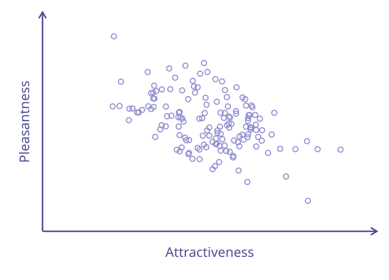
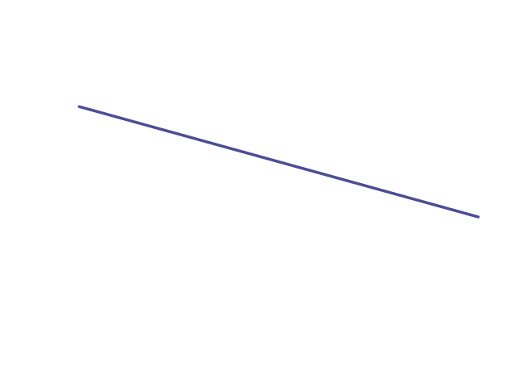
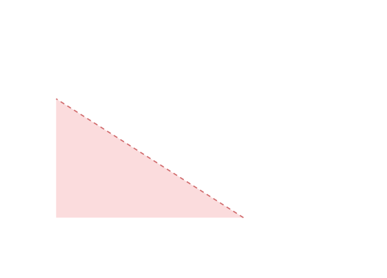
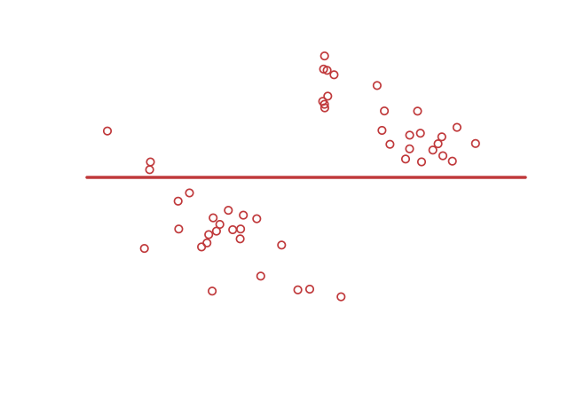
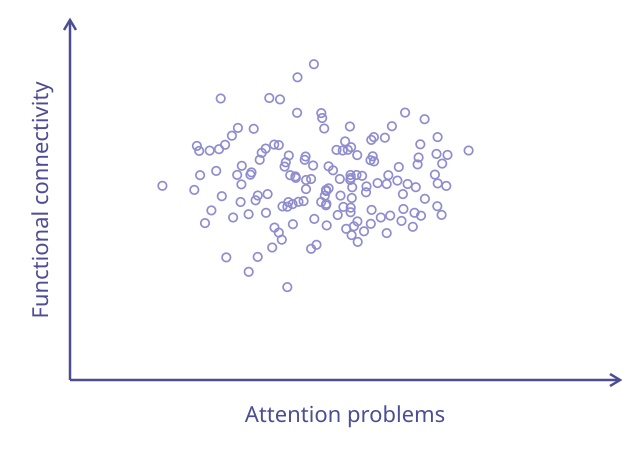
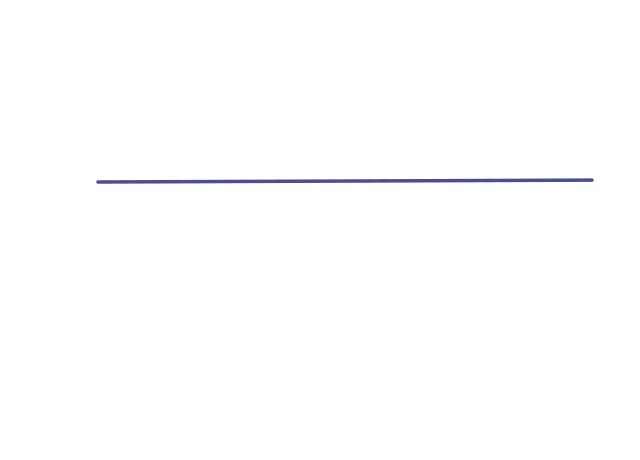
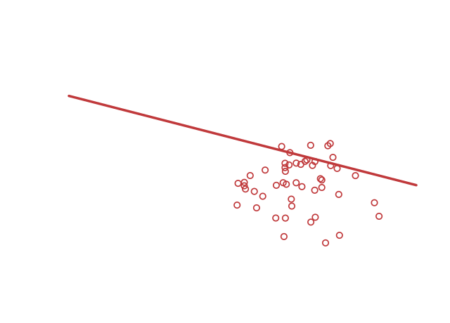
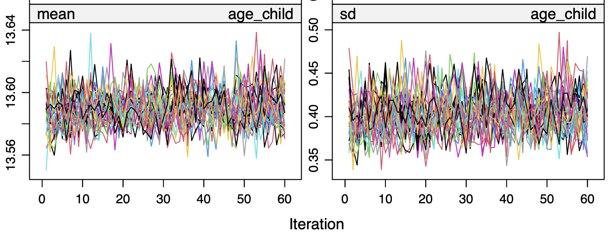
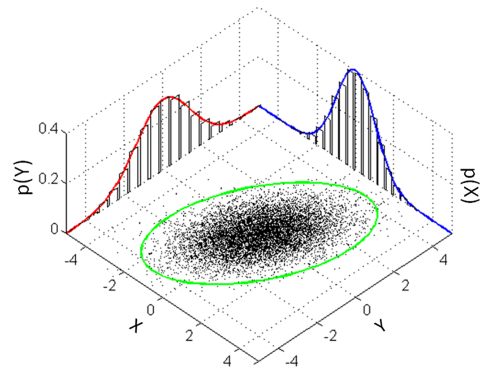

## {.title-slide-pptx .bgslide style="background-image: url(images/bg/base.jpg);"}

{.t-tree}
{.t-poster}

::: {.t-lead}
MISSING<br>DATA:
:::

::: {.t-echo}
what do I do?
:::

::: {.t-sub}
***Why*** and ***how*** to handle missing values in (longitudinal) research
:::

::: {.notes}
As I began learning about MI, I realized that there are a lot of guidelines that are not often followed… or, if they are, nobody reports what they did… or the guidelines are outdated and/or different across disciplines.

Objectives:
- Understand the challenges and implications of missing data in research
- Classify missing data by patterns and mechanisms using Rubin’s framework
- Recognize the limitations of outdated missing data methods
- Explore the design and application of planned missing data methods
:::

## This talk map {.bgslide style="background-image: url(images/bg/base.jpg);"}

::: {.map}
::: {.map-sec .sec1}
[1]{.map-num} [Do I have a missing data *problem*?]{.map-head}

[Selection bias]{.chip} [Missing mechanisms]{.chip} [m-graphs]{.chip} 
:::

::: {.map-sec .sec2}
[2]{.map-num} [Missing data handling (*defence*)]{.map-head}

e.g. techniques [MI]{.chip} [FIML]{.chip} [IPW]{.chip} [Bayesian methods]{.chip}
:::

::: {.map-sec .sec3}
[3]{.map-num} [Missing data designs (*offence*)]{.map-head}

e.g. [accelerated longitudinal designs]{.chip}
:::

::: {.map-sec .sec4}
[4]{.map-num} [FAQs and other things I have opinions on]{.map-head}

[too much / to little missing]{.chip} ["making up data"]{.chip} [data leaks]{.chip}
:::
:::

## {.divider .sec1 .bgslide style="background-image: url(images/bg/frame-orange.jpg);"}

{.div-art .nostretch}

[1]{.num-circle .div-num}

::: {.dtitle}
Do I have a missing data *problem*?
:::

::: {.notes}
Missing data is everywhere. It is pervasive across disciplines
Part 1: why should we care, how do we describe the problem (mechanisms, DAGs)
:::

## Something's missing … {.missing-demo .sec1 .bgslide style="background-image: url(images/bg/frame-orange.jpg);"}

{.nancy}



::: {.eq}
$$\mathbf{Y} = \boldsymbol{\alpha} + \boldsymbol{\beta}_\mathbf{1} \cdot \textbf{X1} + \boldsymbol{\beta}_\mathbf{2} \cdot \textbf{X2}$$
:::

::: {.n6}
*N* = 6
:::

::: {.fragment}
{.down-arrow}

::: {.dark-red}
"listwise" / "pairwise" deletion
:::

::: {.n3}
*N* = [3]{.n3-num}
:::
:::

::: {.notes}
Missing data are a common challenge in research, particularly in longitudinal studies, where gaps in data can complicate the interpretation of changes over time.

The easiest way to handle missing data is to exclude participants with missing data = listwise / pairwise deletion. Default in several statistical software.
:::

## [Step 1]{.label}: admit that you have a problem {.sec1 .bgslide style="background-image: url(images/bg/frame-orange.jpg);"}

::: {.step1-lead}
😕 *Wasteful* {.arr-inline} lower statistical power

😱 [**Biased results**!]{.hl} {.arr-inline} inaccurate conclusions
:::

::: {.fragment}
:::: {.columns .step1}
::: {.column width="48%"}

::: {.indent}
Mishandling missing data has serious implications for both the
**[external]{.ul} & [internal]{.ul} validity** of research findings.

Generalisability vs. *bias*
:::

:::

::: {.column width="46%"}
```{=html}
<svg class="dag-ays" viewBox="0 0 440 170" width="440" height="170">
  <defs>
    <marker id="ays-i" viewBox="0 0 12 12" refX="10" refY="6" markerWidth="8" markerHeight="8" orient="auto-start-reverse"><path d="M1,1 L11,6 L1,11" fill="none" stroke="#4D4D95" stroke-width="2" stroke-linecap="round" stroke-linejoin="round"/></marker>
    <marker id="ays-r" viewBox="0 0 12 12" refX="10" refY="6" markerWidth="8" markerHeight="8" orient="auto-start-reverse"><path d="M1,1 L11,6 L1,11" fill="none" stroke="#FF8163" stroke-width="2" stroke-linecap="round" stroke-linejoin="round"/></marker>
  </defs>
  <path d="M45 94 C 80 18, 350 14, 383 90" fill="none" stroke="#4D4D95" stroke-width="3" stroke-linecap="round" marker-end="url(#ays-i)"/>
  <rect x="5" y="96" width="80" height="44" rx="14" fill="#FFFFFF" stroke="#4D4D95" stroke-width="2.5"/>
  <rect x="180" y="96" width="80" height="44" rx="14" fill="#FFFFFF" stroke="#4D4D95" stroke-width="2.5"/>
  <rect x="345" y="96" width="80" height="44" rx="14" fill="#FFE3DB" stroke="#FF8163" stroke-width="3"/>
  <g font-size="21" font-weight="700" fill="#4D4D95" text-anchor="middle">
    <text x="45" y="125">A</text><text x="220" y="125">Y</text><text x="385" y="125">S</text>
  </g>
  <path d="M88 118 C 115 112, 145 122, 174 118" fill="none" stroke="#FF8163" stroke-width="3" stroke-linecap="round" marker-end="url(#ays-r)"/>
  <path d="M263 118 C 290 114, 315 122, 339 118" fill="none" stroke="#4D4D95" stroke-width="3" stroke-linecap="round" marker-end="url(#ays-i)"/>
</svg>
```

[*"collider bias"*]{.hl .collider}
:::
::::

::: {.example-hint}
Let's look at an example…
:::

:::


::: {.notes}
Mishandling missing data can:
 - Reduce statistical power
 - Bias results –> Inaccurate conclusions

Strong validity hinges on the principle of randomisation, which assumes random and independent sampling from the population.

Removing participants with missing data can introduce sampling bias,ultimately undermining the goal of creating a representative sample.

When the missing data are linked to key variables, deleting these cases may skew the sample.
:::

## [Research question:]{.h2-light}<br>[Are attractive people a\*\*\*oles?]{.hl} {.collage .sec1 .bgslide style="background-image: url(images/bg/frame-orange.jpg);"}

[Background:]{.bg-label}

{.c1}
{.c2}
{.c3}
{.c4}

## [Experimental data]{.label} {.scatter .sec1 .bgslide style="background-image: url(images/bg/frame-orange.jpg);"}

<!-- layers made by scripts/make_scatter.py -->
{.plot .nostretch}

::: {.fragment}
{.plot .nostretch}
:::

::: {.fragment}
{.plot .nostretch}
:::

::: {.fragment}
{.plot .nostretch}
:::

::: {.fragment}
{.plot .nostretch}
:::

::: {.notes}
Whether this will happen depends on the underlying missingness mechanism.
:::

## [Another *~less silly~* example]{.label} {.scatter .sec1 .bgslide style="background-image: url(images/bg/frame-orange.jpg);"}

<!-- layers made by scripts/make_scatter.py (second example) -->
{.plot .nostretch}

{.plot .nostretch}


::: {.fragment}
{.plot .nostretch}
:::

[Simulated data; see @siegel2017]{.cite .scatter-cite}

::: {.notes}
Simulated example, 200 children. In everyone there is a real negative
association between attention problems and this connectivity measure
(r ≈ −0.4). Children with more attention problems move more, and high-motion
scans also tend to show lower (long-range) connectivity, so the 25% of scans
that fail QC sit in the high-attention-problems / low-connectivity corner.

The scans that pass QC show essentially no association (r ≈ 0): the exclusion
removed exactly the children who carried the effect. Exclusion for motion is
selection on variables related to the question, so it can hide a real effect
(as here) or create a spurious one (previous slide).

Siegel et al. (2017): in HCP data 23 of 122 behavioural, demographic and
physiological measures correlate with head motion, and data-cleaning choices
substantially alter reported FC–behaviour relationships.
:::

## Missingness mechanisms {.sec1 .bgslide style="background-image: url(images/bg/frame-orange.jpg);"}

:::: {.columns .mech-row}
::: {.column width="31%"}
::: {.mech}
[MCAR]{.pill .pill-mcar}

The probability of missingness does **not** depend on observed or unobserved
data
:::
:::

::: {.column width="31%"}
::: {.mech}
[MAR]{.pill .pill-mar}

The probability of missingness depends on **observed** data, but not on
unobserved data
:::
:::

::: {.column width="31%"}
::: {.mech}
[MNAR]{.pill .pill-mnar}

The probability of missingness depends on **unobserved** data
:::
:::
::::

{.corner-l}
{.corner-r}

[[@rubin1976; @littlerubin2019; @vanbuuren2018]]{.cite .bottom-cite}

::: {.notes}
Traditional terminology (Rubin, 1976; Little and Rubin).

MCAR: e.g. equipment failure, experimenter error, data transfer error. The best
situation: even listwise deletion is unbiased, just wasteful. It is not common.

MAR: missingness depends on observed variables. E.g. lower household income
predicts missed visits, and income is measured. Listwise deletion under MAR
gives a non-representative sample and biased results, but the cause can be
traced in the data.

MNAR: missingness depends on the missing values themselves (or on something
unmeasured). Under MAR the cause of dropout is in your data; under MNAR it is
not.

Note: these assumptions are closely related to i.i.d.; violations of MCAR or
MAR induce dependence or non-random patterns that undermine standard inference.
:::

## So how do I know which missingness mechanism applies? [⇢ YOU DON'T.]{.you-dont} {.dont-know .sec1 .bgslide style="background-image: url(images/bg/frame-orange.jpg);"}

::: {.test-col}
Test the **MCAR** assumption:

- *T*- or χ²-test
- Little's MCAR test [[@little1988]]{.cite}

```{.r filename="R"}
naniar::mcar_test(data)
```
:::

{.arr-up .nostretch}
{.arr-down .nostretch}

::: {.res-sig}
[Significant]{.res-head}

Data [violate]{.ul} the MCAR assumption
:::

::: {.res-ns}
[Not significant]{.res-head}

MCAR assumption is *plausible*<br>*… but so is NMAR*
:::


::: {.notes}
Missing data mechanisms are identifiable in theory, but in practice it is difficult to tell which is at play.

Little's test sets the null to "the data are MCAR", so failure to find significance is commonly taken as "in the clear". Enders (2022) argues the test does not isolate auxiliary variables associated with missingness and tests an omnibus hypothesis unlikely to hold in the first place. It is underpowered,
especially with few variables, weak associations, and when data are MNAR.

Significant: the data are MAR or MNAR, but you do not learn which. Not significant: MCAR is plausible, but so is MNAR.
:::

## Other diagnostics {.diag .sec1 .bgslide style="background-image: url(images/bg/frame-orange.jpg);"}

:::: {.columns}
::: {.column width="41%"}
1. **Missing data patterns**<br>
   How much is missing, in which variables, in which combinations, and what
   predicts it [[@enders2022]]{.cite}

2. **Missingness DAGs** (*"m-graphs"*)<br>
   Add a node for each missingness indicator and draw its causes
   → which estimates are recoverable [[@morenobetancur2018; @lee2023]]{.cite}
:::

::: {.column width="52%"}
::: {.panel-tabset}

### R

```{.r}
library(naniar); library(mice)

# 1. patterns
miss_var_summary(d)   # % missing per variable
vis_miss(d)           # where are the holes?
gg_miss_upset(d)      # most common combinations
md.pattern(d)         # pattern matrix

# what predicts missingness? (auxiliary variables)
d$miss_y <- is.na(d$y)
glm(miss_y ~ age + sex + ses + motion,
    family = binomial, data = d)

# 2. m-graph
library(dagitty)
g <- dagitty("dag { X -> Y; X -> R_Y; motion -> R_Y }")
plot(graphLayout(g))
```

### Python

```{.python}
import missingno as msno
import statsmodels.formula.api as smf

# 1. patterns
df.isna().mean()      # % missing per variable
msno.matrix(df)       # where are the holes?
msno.heatmap(df)      # do variables go missing together?
msno.bar(df)          # counts per variable

# what predicts missingness? (auxiliary variables)
df["miss_y"] = df["y"].isna().astype(int)
smf.logit("miss_y ~ age + sex + ses + motion",
          data=df).fit().summary()
```

:::
:::
::::

::: {.notes}
Little's test cannot tell you the mechanism. These steps tell you what to condition on.
Logistic regressions predicting missingness are more useful as an exploratory step to understand patterns than as a test of the mechanism. Their main use is to find auxiliary variables (Collins et al., 2001): variables that predict missingness and/or the incomplete variable itself. Including them makes MAR more plausible and recovers precision.

A missing data pattern refers to the configuration of observed and missing values in a data set (what you observe in data)
A missing data mechanism refers to processes that describe different ways in which the probability of missing values relates to the data (typically untestable, is assumed) 
Patterns describe where the holes are in the data, mechanisms describe why the values are missing
:::

## {.divider .sec2 .bgslide style="background-image: url(images/bg/frame-green.jpg);"}

{.div-art .nostretch}

[2]{.num-circle .div-num}

::: {.dtitle}
Missing data handling (*defence*)
:::

::: {.notes}

Part 2a: methods for the data you already have. Part 2b: designing studies so that less is missing, or missing on purpose.
:::

## Outdated methods · [**Deletion**]{.hl} {.deletion-slide .acc-slide .scrollable .sec2 .bgslide style="background-image: url(images/bg/frame-mint.jpg);"}

"Handle" missing data by deleting observations

::: {.acc}
### **Listwise deletion**: drop the whole row if any variable is missing
- Default in software that does not maximise a likelihood (e.g. OLS)
- In R, `lm()` silently drops every row with a missing value
:::

::: {.acc}
### **Pairwise deletion**: drop a pair only when one of its two values is missing
- Uses more data than listwise deletion
- In R, `cor(df, use = "pairwise.complete.obs")`
- Each correlation comes from a different subset, so the matrix can be non-invertible: a problem when it feeds into other models
:::

::: {.assume-box}
Assumes: **MCAR**

Limitations: **less power** (if MCAR); **biased estimates** (!) under MAR or MNAR
:::

[*Defence* · **Outdated methods** | Deletion]{.foot}


## Outdated methods · [**Single imputation**]{.hl} {.acc-slide .scrollable .sec2 .bgslide style="background-image: url(images/bg/frame-mint.jpg);"}

Replace missing data (*impute*) with some type of value, ***once***.

::: {.acc}
### **Unconditional mean / median imputation**
- Replaces missing values in a variable with its estimated mean
- Unconditional = without any input from other variables
- e.g. `MeanImputer()` in `sklearn`
:::

::: {.acc}
### **Conditional mean imputation**
- Replaces missing values with predicted values from a regression (conditional means)
- More accurate than unconditional mean imputation
- But still biased parameters and SEs
:::

::: {.acc}
### **Stochastic conditional mean imputation**
- Adds a random component: the error term of each regression equation
- Assumes MAR rather than MCAR
- Better than the other methods (and the basis for multiple imputation)
:::

::: {.acc}
### **Imputation by proximity: hot deck matching**
- Uses real data from other observations, "matched" on similar scores
- Upside: preserves univariate distributions; values stay in a plausible range
- Downside: biased estimates (especially regression coefficients), SEs too small
- e.g. K-nearest neightbour and predictive mean matching
:::

::: {.acc}
### **Last observation carried forward (LOCF)**
- Common in longitudinal data: drop-outs keep their last observed score
- Assumes scores do not change after dropout: a bad idea
- Thought to be conservative, but can exaggerate group differences and shrinks the SEs used to test them
:::

::: {.assume-box}
Upside: you can use the entire data set

Limitations: 

- treats a guess as a measured value → SEs too small, *p*-values too optimistic (**Type I errors**)
- can **bias estimates** (in either direction), <ins>even under MCAR</ins>! [[@littlerubin2019; @schafer2002]]{.cite}
- mean imputation shrinks variances and correlations, regression imputation inflates them
:::

[*Defence* · **Outdated methods** | Single imputation]{.foot}

::: {.notes}
Single imputation methods (mean replacement, regression, etc.) assume perfect estimation of imputed values and ignore between-imputation variability.
Artificially small standard errors and more Type I errors. Imputed values from deterministic regression imputation lie right on the regression line; real data always deviate from it.
:::

## Modern methods {.acc-slide .scrollable .sec2 .bgslide style="background-image: url(images/bg/frame-mint.jpg);"}

Use **all** the observed information, and carry the uncertainty about the missing values into the results.

::: {.acc}
### **Bayesian estimation**: prior beliefs + data likelihood
- Missing values are treated as *extra parameters* and drawn together with the model at every MCMC step
- Joint model imputation: assume a multivariate distribution (μ, Σ; latent variables for categorical data) and draw from it
- Handles interactions and non-linear terms coherently (`brms::mi()`, `JointAI`, Blimp)
- Check MCMC convergence and autocorrelation (thinning, parallel chains)

[[@bartlett2015; @erler2016]]{.cite}
:::

::: {.acc}
### **Multiple imputation (MI)**: fill in plausible values, several times
- **Impute → analyse → pool** [[@rubin1987]]{.cite}; the spread between datasets *is* the extra uncertainty
- Joint modelling or fully conditional specification (FCS / chained equations, `mice`), one model per variable: regression, PMM, CART / random forest
- Check convergence (trace plots, PSR < 1.05); pool with Rubin's rules; FMI shows how much each estimate depends on the missing data
- Agnostic (flexible, reusable datasets) vs model-based (tailored to one analysis); use *M* ≥ 20, often 100+
:::

::: {.acc}
### **Full-information maximum likelihood (FIML)**: estimate from the observed data
- Row-by-row likelihood using only the variables each row has: nothing is filled in
- One step, deterministic; `lavaan` (`missing = "fiml"`), `OpenMx`, Mplus, not `lme4`
- Multivariate normality → use robust SEs; exogenous predictors are still dropped unless `fixed.x = FALSE`
- Auxiliary variables need extra work (saturated correlates)
:::

::: {.acc}
### **Inverse-probability weighting (IPW)**: re-weight the complete cases
- Model the probability of being complete; weight each complete case by 1 / *p*
- Two key choices: the grouping variable (which outcome is missing) and the balancing covariates; trim extreme weights
- `twang::ps()`, `WeightIt`
- Analysis still uses complete cases only: same effective sample size as listwise deletion
:::

::: {.compare-box}
**Assumes:** MAR

**Compared:** FIML and Bayesian estimation handle the missing data "behind the scenes" while fitting the model; MI separates imputation from analysis, so it is more flexible with auxiliary variables and the datasets can be reused. With the same variables and assumptions they usually agree. IPW is consistent if the weight model is right, but less efficient. [[@enders2022]]{.cite}
:::

[*Defence* · **Modern methods**]{.foot}

::: {.notes}
- Bayesian Estimation: Combines prior beliefs with data likelihood

e.g. Includes Joint Model Imputation 

Assumes incomplete variables follow a multivariate distribution (often multivariate normal, potentially with latent variables for categorical data)
Imputes missing values based on the conditional distributions derived from the estimated joint distribution parameters (𝝁,𝚺
)
Requires careful consideration of MCMC convergence and autocorrelation when saving imputed datasets (using thinning or parallel chains)
Number of imputations (𝑀) impacts power and stability (often 𝑀≥20, practically 𝑀=100+ used)

- Multiple Imputation (MI): Reflects uncertainty by filling in missing data with plausible values
Proposed by Donald Rubin in 1977 for missing survey data. Seminal text published in 1987. Usage has grown significantly since

Diversity: MI includes a diverse collection of procedures
Puts filled-in data “front and center”
Goal: Create suitable imputations for later analysis

Fully Conditional Specification (FCS) is also known as Chained Equations imputation (often associated with the MICE algorithm/package)
Contrast with JM: Instead of working from an assumed multivariate distribution (like JM), FCS specifies the imputation model as a sequence of univariate regression models, one for each variable with missing data
Flexibility: Naturally handles mixtures of categorical and continuous variables, skip patterns, or other situations where a single joint distribution is hard to specify

Agnostic Imputation
Definition: The imputation model differs from the substantive analysis model
Goal: To apply a flexible, nonrestrictive model not dedicated to one specific analysis
The resulting imputed datasets could potentially be used for several different analyses
Crucial: The imputation model must still be flexible enough to preserve important features of the planned secondary analyses and not impose conflicting restrictions

Model-Based Imputation
Definition: The imputation model is the same as the focal analysis model (though it might include additional auxiliary variables)
Goal: To tailor the imputations specifically for one analysis model
This approach is necessarily narrow in scope compared to agnostic imputation

Joint model imputation uses Bayesian estimation, but the primary aim is saving filled-in datasets, not interpreting the imputation model parameters themselves

- Full-Information Maximum Likelihood (FIML): Estimates parameters directly from observed data likelihood


- Inverse-probability Weighting

in FIML & Bayesian Estimation: Primary goal: Fit a model to observed data and use estimates for research questions. Missing data handling occurs “behind the scenes”
FIML deduces missing parts via the normal curve; Bayesian imputes values en route to parameters Imputation is a means to an end (getting estimates)

ML and Bayesian methods estimate parameters directly from the observed data, handling missingness implicitly within the model estimation. MI separates the handling of missing data (imputation stage) from the substantive analysis (analysis/pooling stages)
Equivalence: Often yield similar results when using the same variables and assumptions. MI’s flexibility with auxiliary variables can sometimes be an advantage

Contrast:
Bayesian analysis summarizes posterior distributions over thousands of MCMC iterations
Multiple Imputation (MI) performs frequentist analyses on a much smaller collection (𝑀) of filled-in datasets
:::

## {.bgslide style="background-image: url(images/slides/p13.jpg);"}

::: {.notes}

The Multiple Imputation Process: 3 Steps
1. Imputation:
Specify an imputation model
Use an MCMC algorithm to create multiple (M) copies of the data, each with different imputed values
Often uses MCMC algorithms for regression models or covariance matrices
2. Analysis:
Perform the desired analysis (or analyses) on each of the M completed datasets
Obtain point estimates and standard errors from each analysis
Compatible with the frequentist statistical paradigm
3. Pooling:
Combine the estimates and standard errors from the M analyses into a single set of results
Uses “Rubin’s rules”

Multiple imputation: draw several values for each missing data point, using a statistical model that describes the data, plus a random error component. This gives multiple (slightly) different outcomes of the analyses.

Unlike single imputation, MI incorporates the error inherent in estimating missing data into the standard errors. The results from each imputed dataset are combined with Rubin's rules (Rubin, 1987).

MI is most appropriate for MCAR or MAR data. Simulation studies show it recovers estimates close to the complete-data ones (Collins et al., 2001).
:::

## [1.]{.mint-dark} Create [*plausible*]{.hl} complete data sets {.mi-create .sec2 .bgslide style="background-image: url(images/bg/frame-mint.jpg);"}

[Joint modelling]{.mc-jm}
{.mc-arr1 .nostretch}
[e.g.]{.mc-eg1}
[Bayesian latent variable<br>imputation (BLIMP)]{.mc-pill .mc-blimp}
[jomo]{.mc-pill .mc-jomo}

[OR]{.mc-or}

[Fully conditional<br>specification<br>(MICE)]{.mc-fcs}
{.mc-arr2 .nostretch}
[e.g.]{.mc-eg2}
[Regression approach]{.mc-pill .mc-reg}
[Predictive mean matching (PMM)]{.mc-pill .mc-pmm}
[CART / Random forest]{.mc-pill .mc-cart}

[*Defence* · Modern methods · **Multiple imputation**]{.foot}

::: {.notes}
Two main approaches: joint modelling (Schafer, 1997), used less often nowadays, and fully conditional specification (van Buuren et al., 2006).

Within FCS: the regression approach (random draws from a conditional
distribution) and predictive mean matching (the observed value of a matching respondent). CART / random forest for interactions and non-linearity (Shah et al., 2014; Stekhoven & Bühlmann, 2012).
:::

## Procedure {.mi-proc .sec2 .bgslide style="background-image: url(images/bg/frame-mint.jpg);"}

```{=html}
<div class="pr-step pr-s1"><span class="pr-n">1)</span><span>Fill in starting values, based on the variables’ marginal distributions.</span></div>
<div class="pr-box pr-yellow"></div>
<div class="pr-box pr-lav"></div>
<div class="pr-box pr-green"></div>
<div class="pr-step pr-s0">For each variable X with missing values:</div>
<div class="pr-step pr-s2"><span class="pr-n">2)</span><span>Fit a (e.g. regression) model for predicting its missing values.</span></div>
<div class="pr-step pr-s3"><span class="pr-n">3)</span><span>Based on the model, replace the missing data with:</span></div>
<div class="pr-pill pr-red">Random draws from the<br>conditional distribution</div>
<div class="pr-pill pr-yel">The observed value of a<br>“matching respondent”</div>
<div class="pr-step pr-s4"><span class="pr-n">4)</span><span>Repeat until properties of the imputed values (i.e., means and SDs) stabilize.</span></div>
<div class="pr-step pr-s5"><span class="pr-n">5)</span><span>Repeat <b>M</b> times to obtain <b>M</b> multiply imputed data sets.</span></div>
```

[*Defence* · Modern methods · **Multiple imputation**]{.foot}

::: {.notes}
Regression approach: random draws from a conditional distribution (linear regression for continuous variables, (multinomial) logistic for categorical).

PMM: the regression model finds cases whose predicted values resemble those of
the respondent with the missing value; a matching respondent is randomly
selected and their observed value is used.

Many MI procedures use Bayesian estimation and MCMC.
:::


## {.diag .code-meme .sec2 .bgslide style="background-image: url(images/bg/frame-mint.jpg);"}

:::: {.columns}
::: {.column width="41%"}
::: {.meme}
{.nostretch}

[Multiple imputation: **theory**]{.meme-label .meme-theory}
[Multiple imputation: **code**]{.meme-label .meme-code}
:::
:::

::: {.column width="52%"}
::: {.panel-tabset}

### R

```{.r}
library(mice)
meth <- make.method(data,
          defaultMethod = c("rf", "pmm", "polyreg"))

imp <- futuremice(data, method = meth,
                  m = 20, maxit = 40,
                  n.core = 5, parallelseed = 3108)
# sequential: mice(data, method = meth, m = 20)

fit <- with(imp, lm(cbcl ~ thickness + age + sex))
summary(pool(fit))
```

### Python

```{.python}
from sklearn.experimental import enable_iterative_imputer
from sklearn.impute import IterativeImputer

imps = [IterativeImputer(sample_posterior=True,
                         random_state=m).fit_transform(X)
        for m in range(20)]
# fit the model on each, pool with Rubin's rules

import miceforest as mf          # LightGBM MICE
kds = mf.ImputationKernel(df, num_datasets=20,
                          random_state=1)
kds.mice(5)
```

[`IterativeImputer` gives **one** imputation by default: you need
`sample_posterior=True`, several seeds and pooling by hand.]{.smaller .coral}

:::
:::
::::

[*Defence* · Modern methods · **Multiple imputation**]{.foot}

## Assessing convergence {.mi-conv .scrollable .sec2 .bgslide style="background-image: url(images/bg/frame-mint.jpg);"}

It's important to evaluate MCMC convergence *before* saving the imputed datasets.

Diagnostics:

::: {.panel-tabset}

### Trace plots

:::: {.columns}
::: {.column width="58%"}
```{.r}
plot(imputation_list)
```

{.conv-plot .nostretch}
:::

::: {.column width="38%"}
::: {.conv-text}
One or more parameters (e.g., mean and SD) against the iteration number: the sequence of imputed values, from starting value to final imputed value.

The streams should be **freely intermingled**: the variance *between* chains (lines) should equal the variance *within* chains.
:::

[More about convergence?<br>[van Buuren, FIMD §6.5](https://stefvanbuuren.name/fimd/sec-algoptions.html)]{.conv-more}
:::
::::

### Potential Scale Reduction Factor (PSR; $\hat{R}$)

::: {.psr}
Measures the similarity of MCMC chains started from different random values [[@gelmanrubin1992]]{.cite}

$$\text{PSR} = \frac{\text{total variance}}{\text{average within-chain variance}}$$

```{.r}
mice::convergence(imp, diagnostic = "all", parameter = "mean")
```

As the *between-chain variation* (discrepancies across chains) → 0, the total variance → the average within-chain variance, so PSR → 1.

Common cut-off: PSR < 1.05
:::

:::

[*Defence* · Modern methods · **Multiple imputation**]{.foot}

::: {.notes}
Convergence check, regardless of using sequential or parallel chains.
Goal: ensure the MCMC process has converged and is mixing well.

The potential scale reduction factor (Gelman and Rubin, 1992) captures the
similarity of MCMC chains initiated from different starting values. It is a ratio of the total variance and the average within-chain variance. PSR < 1.05 is considered converged. If it never converges, re-evaluate the model: common for complex longitudinal data sets (Sterne et al., 2009).
:::

## 3. Pool estimates: [Rubin's rules]{.hl} {.mi-rubin .sec2 .bgslide style="background-image: url(images/bg/frame-mint.jpg);"}

:::: {.columns}
::: {.column width="45%"}
Pooled [**point estimate**]{.c-pe}: average of point estimates from each dataset

$$\bar{\theta} = \frac{1}{M}\sum_{m=1}^{M}\hat{\theta}_m$$

Where:

$\hat{\theta}_m$ is the parameter estimate from the $m$th imputed dataset

$\bar{\theta}$ is the pooled estimate across all $M$ imputations.
:::

::: {.column width="51%"}
Pooled [**standard error**]{.c-se} estimate: incorporate corrections for the potential *inflation of the estimate due to sampling error*.

$$SE_{\bar{\theta}} = \sqrt{\color{#4FA8E0}{V_W} + \left(1 + \frac{1}{M}\right)\color{#7DB83A}{V_B}}$$

Where:

$\color{#4FA8E0}{V_W = \frac{1}{M}\sum_{m=1}^{M} SE_m^2}$ is the [within-imputation variance]{.c-vw} (i.e. mean of the squared standard errors from each imputed dataset)

$\color{#7DB83A}{V_B = \mathrm{var}(\hat{\theta}_m)}$ is the [between-imputation variance]{.c-vb}.
:::
::::

[[@rubin1987]]{.cite .bottom-cite .left}

[*Defence* · Modern methods · **Multiple imputation**]{.foot}

::: {.notes}
Once the model converges, the analysis model is fitted to each imputed
dataset and the parameters are pooled.

The pooled SE combines the within-imputation variance (sampling variability)
with the between-imputation variance (uncertainty due to missing data). The
factor 1 + 1/M adjusts for using a finite number of imputations.
:::

## {.mi-fmi .sec2 .bgslide style="background-image: url(images/bg/frame-mint.jpg);"}

:::: {.columns}
::: {.column width="70%"}
```{.r}
## Fit models for each imputed dataset
fit <- with(data = imp, exp = lm(bmi ~ hyp + chl))
## Pool results
poolFit <- pool(fit)
## Print: the FMI for each coefficient is shown
poolFit
```

```{=html}
<pre class="r-out"><code>## Call: pool(object = fit)
##
## Pooled coefficients:
## (Intercept)         hyp         chl
##    21.97735    -0.60095     0.02799
##
## Fraction of information about the coefficients missing due to nonresponse:
## (Intercept)         hyp         chl
##      0.2373      0.2159      0.2855</code></pre>
```

```{.r}
## Summary
summary(poolFit)
```

```{=html}
<pre class="r-out"><code>##                  est      se      t    df Pr(&gt;|t|)    lo 95    hi 95 nmis    fmi lambda
## (Intercept) 21.97735 4.50724  4.876 15.81 0.000174 12.41296 31.54175   NA 0.2373 0.1466
## hyp         -0.60095 1.97686 -0.304 16.52 0.764929 -4.78108  3.57918    8 <mark class="fmi-hl">0.2159</mark> 0.1264
## chl          0.02799 0.02245  1.247 14.23 0.232568 -0.02008  0.07607   10 0.2855 0.1916</code></pre>
```
:::

::: {.column width="26%"}
::: {.fmi-side}
[OR<br>`mitml`]{.fmi-or}

[Fraction of missing information]{.fmi-title}

**: variation due to missing data accounts for ~22% of the squared SE for the "hyp" predictor.**
:::
:::
::::

```{=html}
<svg class="fmi-arrow" viewBox="0 0 130 70"><g fill="none" stroke="#C77DB8" stroke-width="2" stroke-linecap="round">
<path d="M6 64 C 40 66, 60 50, 70 30 C 80 12, 100 8, 124 8"/><path d="M114 2 L124 8 L114 15"/></g></svg>
```

[*Defence* · Modern methods · **Multiple imputation**]{.foot}

::: {.notes}
Fraction of missing information (Rubin, 1987): how much of a coefficient's
variance is due to the missing data. Divide the between-imputation term, scaled
by 1 + 1/M, by the total variance. Watch FMI as you add auxiliary variables:
the ones that reduce it are earning their place.
:::

## {.bgslide style="background-image: url(images/slides/p28.jpg);"}

## {.mi-fiml .sec2 .bgslide style="background-image: url(images/bg/frame-mint.jpg);"}

```{=html}
<div class="fiml-lab fl-obs">Observed correlation matrix</div>
<div class="fiml-lab fl-imp">Model-implied correlation matrix</div>

<div class="fl-a1">A1</div>
<div class="fl-a2">A2</div>
<div class="fiml-table">
<table class="impl"><thead><tr><th></th><th>A1</th><th>A2</th><th>A3</th><th>Y1</th><th>Y2</th><th>Y3</th></tr></thead><tbody>
<tr><th>A1</th><td>var(<i>e</i><sub>A1</sub>)<br>+ <i>λ</i><sup>2</sup><sub>A1</sub></td><td></td><td></td><td></td><td></td><td></td></tr>
<tr><th>A2</th><td><i>λ</i><sub>A1</sub><i>λ</i><sub>A2</sub></td><td>var(<i>e</i><sub>A2</sub>)<br>+ <i>λ</i><sup>2</sup><sub>A2</sub></td><td></td><td></td><td></td><td></td></tr>
<tr><th>A3</th><td><i>λ</i><sub>A1</sub><i>λ</i><sub>A3</sub></td><td><i>λ</i><sub>A2</sub><i>λ</i><sub>A3</sub></td><td>var(<i>e</i><sub>A3</sub>)<br>+ <i>λ</i><sup>2</sup><sub>A3</sub></td><td></td><td></td><td></td></tr>
<tr><th>Y1</th><td><i>λ</i><sub>A1</sub><i>λ</i><sub>Y1</sub></td><td><i>λ</i><sub>A2</sub><i>λ</i><sub>Y1</sub></td><td><i>λ</i><sub>A3</sub><i>λ</i><sub>Y1</sub></td><td>var(<i>e</i><sub>Y1</sub>)<br>+ <i>λ</i><sup>2</sup><sub>Y1</sub></td><td></td><td></td></tr>
<tr><th>Y2</th><td><i>λ</i><sub>A1</sub><i>λ</i><sub>Y2</sub></td><td><i>λ</i><sub>A2</sub><i>λ</i><sub>Y2</sub></td><td><i>λ</i><sub>A3</sub><i>λ</i><sub>Y2</sub></td><td><i>λ</i><sub>Y1</sub><i>λ</i><sub>Y2</sub></td><td>var(<i>e</i><sub>Y2</sub>)<br>+ <i>λ</i><sup>2</sup><sub>Y2</sub></td><td></td></tr>
<tr><th>Y3</th><td><i>λ</i><sub>A1</sub><i>λ</i><sub>Y3</sub></td><td><i>λ</i><sub>A2</sub><i>λ</i><sub>Y3</sub></td><td><i>λ</i><sub>A3</sub><i>λ</i><sub>Y3</sub></td><td><i>λ</i><sub>Y1</sub><i>λ</i><sub>Y3</sub></td><td><i>λ</i><sub>Y2</sub><i>λ</i><sub>Y3</sub></td><td>var(<i>e</i><sub>Y3</sub>)<br>+ <i>λ</i><sup>2</sup><sub>Y3</sub></td></tr>
</tbody></table>
</div>
<svg class="path-diag" viewBox="0 0 520 380" width="520" height="380">
<defs><marker id="pd-a" viewBox="0 0 10 10" refX="9" refY="5" markerWidth="6" markerHeight="6" orient="auto-start-reverse"><path d="M0,0 L10,5 L0,10 z" fill="#5D5DB0"/></marker><marker id="pd-m" viewBox="0 0 10 10" refX="9" refY="5" markerWidth="6" markerHeight="6" orient="auto-start-reverse"><path d="M0,0 L10,5 L0,10 z" fill="#47C5A3"/></marker></defs>
<path d="M130 92 C 190 20, 330 20, 386 90" fill="none" stroke="#47C5A3" stroke-width="2" marker-end="url(#pd-m)"/>
<text x="260" y="38" font-size="20" font-style="italic" fill="#47C5A3" text-anchor="middle">φ</text>
<ellipse cx="130" cy="130" rx="46" ry="34" fill="#FDF0CF" stroke="#F5C14E" stroke-width="2"/>
<text x="130" y="141" font-size="30" font-weight="700" fill="#E39B2B" text-anchor="middle">A</text>
<ellipse cx="390" cy="130" rx="46" ry="34" fill="#FDF0CF" stroke="#F5C14E" stroke-width="2"/>
<text x="390" y="141" font-size="30" font-weight="700" fill="#E39B2B" text-anchor="middle">Y</text>
<rect x="9" y="238" width="72" height="46" fill="#FFFFFF" stroke="#F5C14E" stroke-width="2"/>
<text x="45" y="270" font-size="24" fill="#E39B2B" text-anchor="middle">A1</text>
<line x1="45" y1="238" x2="100.25" y2="164" stroke="#5D5DB0" stroke-width="1.8" marker-end="url(#pd-a)"/>
<text x="77.5" y="210" font-size="20" font-style="italic" fill="#5D5DB0" text-anchor="middle">λ</text>
<circle cx="45" cy="352" r="20" fill="#FDF0CF" stroke="#F5C14E" stroke-width="2"/>
<text x="45" y="360" font-size="22" font-style="italic" fill="#E39B2B" text-anchor="middle">e</text>
<line x1="45" y1="332" x2="45" y2="288" stroke="#5D5DB0" stroke-width="1.8" marker-end="url(#pd-a)"/>
<text x="33" y="316" font-size="18" fill="#5D5DB0" text-anchor="middle">1</text>
<rect x="94" y="238" width="72" height="46" fill="#FFFFFF" stroke="#F5C14E" stroke-width="2"/>
<text x="130" y="270" font-size="24" fill="#E39B2B" text-anchor="middle">A2</text>
<line x1="130" y1="238" x2="130.0" y2="164" stroke="#5D5DB0" stroke-width="1.8" marker-end="url(#pd-a)"/>
<text x="120.0" y="210" font-size="20" font-style="italic" fill="#5D5DB0" text-anchor="middle">λ</text>
<circle cx="130" cy="352" r="20" fill="#FDF0CF" stroke="#F5C14E" stroke-width="2"/>
<text x="130" y="360" font-size="22" font-style="italic" fill="#E39B2B" text-anchor="middle">e</text>
<line x1="130" y1="332" x2="130" y2="288" stroke="#5D5DB0" stroke-width="1.8" marker-end="url(#pd-a)"/>
<text x="118" y="316" font-size="18" fill="#5D5DB0" text-anchor="middle">1</text>
<rect x="179" y="238" width="72" height="46" fill="#FFFFFF" stroke="#F5C14E" stroke-width="2"/>
<text x="215" y="270" font-size="24" fill="#E39B2B" text-anchor="middle">A3</text>
<line x1="215" y1="238" x2="159.75" y2="164" stroke="#5D5DB0" stroke-width="1.8" marker-end="url(#pd-a)"/>
<text x="162.5" y="210" font-size="20" font-style="italic" fill="#5D5DB0" text-anchor="middle">λ</text>
<circle cx="215" cy="352" r="20" fill="#FDF0CF" stroke="#F5C14E" stroke-width="2"/>
<text x="215" y="360" font-size="22" font-style="italic" fill="#E39B2B" text-anchor="middle">e</text>
<line x1="215" y1="332" x2="215" y2="288" stroke="#5D5DB0" stroke-width="1.8" marker-end="url(#pd-a)"/>
<text x="203" y="316" font-size="18" fill="#5D5DB0" text-anchor="middle">1</text>
<rect x="269" y="238" width="72" height="46" fill="#FFFFFF" stroke="#F5C14E" stroke-width="2"/>
<text x="305" y="270" font-size="24" fill="#E39B2B" text-anchor="middle">Y1</text>
<line x1="305" y1="238" x2="360.25" y2="164" stroke="#5D5DB0" stroke-width="1.8" marker-end="url(#pd-a)"/>
<text x="337.5" y="210" font-size="20" font-style="italic" fill="#5D5DB0" text-anchor="middle">λ</text>
<circle cx="305" cy="352" r="20" fill="#FDF0CF" stroke="#F5C14E" stroke-width="2"/>
<text x="305" y="360" font-size="22" font-style="italic" fill="#E39B2B" text-anchor="middle">e</text>
<line x1="305" y1="332" x2="305" y2="288" stroke="#5D5DB0" stroke-width="1.8" marker-end="url(#pd-a)"/>
<text x="293" y="316" font-size="18" fill="#5D5DB0" text-anchor="middle">1</text>
<rect x="354" y="238" width="72" height="46" fill="#FFFFFF" stroke="#F5C14E" stroke-width="2"/>
<text x="390" y="270" font-size="24" fill="#E39B2B" text-anchor="middle">Y2</text>
<line x1="390" y1="238" x2="390.0" y2="164" stroke="#5D5DB0" stroke-width="1.8" marker-end="url(#pd-a)"/>
<text x="380.0" y="210" font-size="20" font-style="italic" fill="#5D5DB0" text-anchor="middle">λ</text>
<circle cx="390" cy="352" r="20" fill="#FDF0CF" stroke="#F5C14E" stroke-width="2"/>
<text x="390" y="360" font-size="22" font-style="italic" fill="#E39B2B" text-anchor="middle">e</text>
<line x1="390" y1="332" x2="390" y2="288" stroke="#5D5DB0" stroke-width="1.8" marker-end="url(#pd-a)"/>
<text x="378" y="316" font-size="18" fill="#5D5DB0" text-anchor="middle">1</text>
<rect x="439" y="238" width="72" height="46" fill="#FFFFFF" stroke="#F5C14E" stroke-width="2"/>
<text x="475" y="270" font-size="24" fill="#E39B2B" text-anchor="middle">Y3</text>
<line x1="475" y1="238" x2="419.75" y2="164" stroke="#5D5DB0" stroke-width="1.8" marker-end="url(#pd-a)"/>
<text x="422.5" y="210" font-size="20" font-style="italic" fill="#5D5DB0" text-anchor="middle">λ</text>
<circle cx="475" cy="352" r="20" fill="#FDF0CF" stroke="#F5C14E" stroke-width="2"/>
<text x="475" y="360" font-size="22" font-style="italic" fill="#E39B2B" text-anchor="middle">e</text>
<line x1="475" y1="332" x2="475" y2="288" stroke="#5D5DB0" stroke-width="1.8" marker-end="url(#pd-a)"/>
<text x="463" y="316" font-size="18" fill="#5D5DB0" text-anchor="middle">1</text>
</svg>
```

::: {.fiml-bullets}
- **FIML** estimates the likelihood function [*"row-by-row"*]{.mint}.<br>Rows with missing data apply likelihood estimation *on the data that are available*.
- …assuming an appropriate distribution (e.g., [*multivariate normal*]{.coral} for continuous data, or multinormal threshold models for binary or ordinal data).
:::

[*Defence* · Modern methods · **FIML**]{.foot}

::: {.notes}
FIML is ML estimation with appropriate incorporation of cases with missing
data (Enders, 2001). Go observation by observation (in practice, pattern by
pattern) and compute each row's likelihood from the part of the model-implied
covariance matrix for which that row has data.
:::

## The FIML trade-offs {.bgslide style="background-image: url(images/bg/frame-mint.jpg);"}

:::: {.columns}
::: {.column width="48%"}
"For missing Y's, full information maximum likelihood (FIML) is preferred"
[(Enders et al., 2020; von Hippel, 2007; Little, 1992)]{.grey}

::: {.box .box-mint}
- **Straightforward**: no imputation step
- One argument: `lavaan::sem(..., missing = "fiml")`
- Same assumptions as MI (MAR)
:::
:::

::: {.column width="48%"}
::: {.box .box-coral .small}
**But**

- Not available everywhere: **✗** `lme4` · **✓** `lavaan`, `OpenMx`, Mplus
- Based on multivariate normality → use **robust SEs**
- Exogenous predictors are still deleted unless `fixed.x = FALSE`
- **Auxiliary variables** need extra work (saturated correlates)
:::
:::
::::

[*Defence* · Modern methods · **FIML**]{.foot}

## {.bgslide style="background-image: url(images/slides/p32.jpg);"}

::: {.notes}
In the missing data context, the "treatment" is: 1 = complete case, 0 = has
missing observations. Estimate the probability of being complete given
covariates, weight complete cases by its inverse. Two critical decisions: the
grouping variable (usually the outcome; may differ by imaging modality) and
the balancing covariates (Seaman & White, 2013: some covariates can introduce
rather than reduce bias).
:::

## {.ipw-note .sec2 .bgslide style="background-image: url(images/bg/frame-mint.jpg);"}

- If [balancing covariates are also missing data]{.coral}, additional dummy variables indicating covariate missingness can be included as balancing covariates [[@dagostino2000]]{.cite}

- [Note]{.ul}: unlike other missing data approaches (e.g., FIML, MI) the analysis is only conducted on (re-weighted) observed cases. Thus, **the effective sample size does not differ** from a model that only includes complete cases.

::: {.discussion}
[Discussion point]{.ul}<br>is IPW ***ever*** preferable to MI or FIML?
:::

[*Defence* · Modern methods · **IPW**]{.foot}

::: {.notes}
Unlike MI and FIML, the analysis is only on re-weighted observed cases: the effective sample size is that of a complete-case analysis.
:::

## Which method, when? {.bgslide style="background-image: url(images/bg/frame-mint.jpg);"}

::: {.compare}
| Method | [MCAR]{.pill .pill-mcar} | [MAR]{.pill .pill-mar} | [MNAR]{.pill .pill-mnar} | R | Python |
|---|---|---|---|---|---|
| Complete case | [Unbiased]{.ok}, wasteful | [Biased]{.bad}* | [Biased]{.bad}* | default | default |
| Mean / single imputation | [SEs too small]{.meh} | [Biased]{.bad} | [Biased]{.bad} | (don't) | `SimpleImputer` (don't) |
| Multiple imputation | [Unbiased]{.ok} | [Unbiased]{.ok} if model right | [Reduces bias]{.meh} | `mice` | `IterativeImputer`, `miceforest` |
| FIML | [Unbiased]{.ok} | [Unbiased]{.ok} | [Reduces bias]{.meh} | `lavaan`, `OpenMx` | `semopy` (limited) |
| IPW | [Unbiased]{.ok}, less efficient | [Unbiased]{.ok} if weights right | [Biased]{.bad} | `twang`, `WeightIt` | by hand (`statsmodels`) |
| SMC-FCS / Bayesian | [Unbiased]{.ok} | [Unbiased]{.ok}, incl. interactions | [Reduces bias]{.meh} | `smcfcs`, `brms`, `JointAI` | PyMC, Stan |
| Multilevel MI | [Unbiased]{.ok} | [Unbiased]{.ok}, keeps clustering | [Reduces bias]{.meh} | `mice` 2l, `jomo`, Blimp | none mature |
| Delta-adjusted MI | | | [Tests robustness]{.ok} | `mice` (`post`) | by hand |
:::

[\* Complete-case regression is unbiased if missingness does not depend on the outcome (given covariates). Explore patterns with `naniar` / `missingno`.]{.smaller .grey}

[Defence · **Summary**]{.foot}

::: {.notes}
Listwise and pairwise deletion assume MCAR. MI and FIML work under MAR because
observed data distributions are reasonable proxies for the complete data
(Hayes and Enders, 2023). Under MNAR no method removes bias, but MI and FIML
reduce it because they still use the dependencies on observed variables, and
unobserved causes are often correlated with observed ones. The more auxiliary
variables you include, the more plausible MAR becomes.

The APA Task Force called listwise and pairwise deletion "among the worst
methods available for practical applications" (Wilkinson et al., 1999).
:::

## {.divider .sec3 .bgslide style="background-image: url(images/bg/frame-lavender.jpg);"}

{.div-art .nostretch}

[3]{.num-circle .div-num}

::: {.dtitle}
Missing data designs (*offence*)
:::

## Prevention {.prevention .sec3 .bgslide style="background-image: url(images/bg/frame-blue.jpg);"}

The best missing data method is **less missing data**: you have more control on the front end than you think.

:::: {.columns}
::: {.column width="55%"}
- **Engagement**: make participants part of something bigger, not just data providers (newsletters with findings, birthday / holiday cards)
- **Practicalities**: prizes or raffles for children, travel costs or rides, flexible scheduling, reminders, the same contact person over waves
- **Know your population**: anticipate motivational, geographic and language barriers (readability, materials and staff in other languages)
- **Tenacity**: contact again; optimise notifications
- **Scanner**: mock scanner, movies, shorter runs, real-time motion monitoring, re-scan slots
- **Keep partial data**: one failed run is not a failed participant
:::

::: {.column width="41%"}
::: {.box .box-sec}
**Measure the mechanism**

- Record **why** each value is missing
- Collect **auxiliary variables** that predict dropout and motion (e.g. symptoms, SES, distance to the lab)
- Write the missing data plan into the **pre-registration**
:::
:::
::::

[*Offence* · **Prevention**]{.foot}

::: {.notes}
There are many places where you, as a researcher, have control to prevent missing data: interest, engagement, motivation; maybe the language you used is not aligned with the needs of a particular segment of the population.

Know your population and anticipate what may be barriers for them to participate (motivational, geographic, language), and try to prevent them.

Language: do you have participants whose first language is not Dutch? You could provide instruments or personnel able to work in other languages. Ask: is that group part of the population you wish to generalise to? Does the phenomenon you study have anything to do with language? Someone may agree to participate but find the whole experience frustrating for communication reasons.

Long-term studies: birthday / holiday cards, newsletters with findings, keep participants involved in the science.

Laurie Chassin's longitudinal studies reach retention rates of around 90%: participants are made to feel part of something bigger, a shared mission rather than just data providers, using a variety of ways to do it.

The other thing is tenacity: contact people again, with optimised notifications.

Auxiliary variables you collect now are what make MAR plausible later. A recorded reason for missingness ("moved away", "scanner broken", "too anxious") is the most direct evidence about the mechanism.
:::

## Planned missingness {.planned .sec3 .bgslide style="background-image: url(images/bg/frame-blue.jpg);"}

:::: {.columns}
::: {.column width="48%"}
### Three-form design

::: {.design}
| | X | A | B | C |
|---|---|---|---|---|
| Form 1 | ✓ | ✓ | ✓ | |
| Form 2 | ✓ | ✓ | | ✓ |
| Form 3 | ✓ | | ✓ | ✓ |
:::

[Everyone answers X; each person skips one block at random. **25% fewer items**,
all correlations estimable.]{.small}
:::

::: {.column width="48%"}
### Accelerated longitudinal design

::: {.design}
| | 9 y | 11 y | 13 y | 15 y | 17 y |
|---|---|---|---|---|---|
| Cohort 1 | ✓ | ✓ | ✓ | | |
| Cohort 2 | | ✓ | ✓ | ✓ | |
| Cohort 3 | | | ✓ | ✓ | ✓ |
:::

[Three waves cover **ages 9–17 in 4 years** instead of 8.]{.small}
:::
::::

::: {.box .box-sec .small}
Missing **completely at random by design**, so MI or FIML recovers the full
information. Also: *two-method designs* (a cheap measure for everyone, the
expensive scan for a random subset).
:::

[[@graham2006; @little2014]]{.cite}

[*Offence* · **Planned missingness**]{.foot}

::: {.notes}
Planned missing data designs (Graham et al., 2006): because the researcher
decides who is missing what, the data are MCAR by design. Three-form design:
shorter questionnaires, more constructs. Accelerated (cohort-sequential)
designs cover a long age span in a short time; they assume the cohorts can be
linked (no strong cohort effects). Two-method measurement: everyone gets the
cheap, noisy measure; a random subset gets the expensive gold standard.
Little et al. (2014), "On the joys of missing data", has worked examples.
:::

## {.divider .sec4 .bgslide style="background-image: url(images/bg/frame-yellow-light.jpg);"}

{.div-photo .nostretch}

[4]{.num-circle .div-num}

::: {.dtitle}
FAQs and other things I have opinions on
:::

## Imputing the outcome (and using it) {.sec4 .bgslide style="background-image: url(images/bg/frame-yellow-band.jpg);"}

:::: {.columns}
::: {.column width="50%"}
### Missing X: include Y in the imputation model

"Conceptually, it makes no sense to predict a predictor…"

[**It doesn't matter.**]{.hl} The imputation model is not a causal model; it
only describes the relations in the data. **Leaving the outcome out biases the
association towards zero.**

[[@moons2006]]{.cite}
:::

::: {.column width="46%"}
### Missing Y: won't imputation confirm my model?

[Not if the imputation, analysis and data-generating models agree.]{.hl}

If only Y is missing and the imputation uses only the analysis covariates,
MI gives the **same** answer as complete-case analysis: no gain, no harm.
Imputing Y helps when **auxiliary variables** carry information.
:::
::::

[*FAQs* · **Imputing the outcome**]{.foot}

::: {.notes}
von Hippel (2007) argued for a step-wise method for missing X's (multiple
imputation, then deletion). We do not advocate that here: advances in
computing power and imputation approaches render the extra steps largely
superfluous.

On imputing Y: if the imputation model contains exactly the analysis
covariates, imputed Y values add no information. Let's see an example where the
models disagree…
:::


## "Too much (or too little) missing data" {.sec4 .bgslide style="background-image: url(images/bg/frame-yellow-band.jpg);"}

:::: {.columns}
::: {.column width="50%"}
**The proportion missing is not what decides bias.** The mechanism and the
information you have about it are.

- 5% MNAR can bias more than 50% MAR
- With good auxiliary variables, MI is useful even with **large** proportions
- And with **little** missing data, MI is still preferred: under MAR or MNAR
  the dropout is **systematic**, not just a loss of power
:::

::: {.column width="46%"}
::: {.big-quote .small}
"Researchers tend to be squeamish about analyses in which there are large
amounts of missing data (≥50%), but it is precisely in these instances when
researchers should be dealing with it."
:::

[[@madleydowd2019; @sterne2009]]{.cite}
:::
::::

[*FAQs* · **How much is too much?**]{.foot}

::: {.notes}
There is no universal threshold. "Too much" depends on design, question, the
strength of the association between missingness and outcomes, the mechanism,
and the methods available. Cut-offs you will see quoted (≤5% inconsequential,
Schafer 1999; 5–20% moderate, Bennett 2001; ≥20% large) are conventions.
Madley-Dowd et al. (2019) show by simulation that the proportion of missing
data should not be used to decide whether to use MI.
:::

## Data leaks {.sec4 .bgslide style="background-image: url(images/bg/frame-yellow-band.jpg);"}

Imputing (or scaling) the **whole dataset before** splitting into train and test lets the test set inform the training data.

[**Always impute inside the cross-validation procedure!**]{.hl}

:::: {.columns}
::: {.column width="48%"}

→ **Inflated prediction performance**, shown directly for connectome-based
models.

::: {.box .box-sec .small}
Fit the imputer on the **training fold only**, then apply it to the test fold.
A pipeline does this for you.
:::

[[@rosenblatt2024; @kapoor2023]]{.cite}
:::

::: {.column width="48%"}
```python
from sklearn.pipeline import make_pipeline
from sklearn.experimental import enable_iterative_imputer
from sklearn.impute import IterativeImputer
from sklearn.preprocessing import StandardScaler
from sklearn.linear_model import RidgeCV
from sklearn.model_selection import cross_val_score

model = make_pipeline(IterativeImputer(),
                      StandardScaler(), RidgeCV())
cross_val_score(model, X, y, cv=10)
# the imputer is re-fitted inside every fold
```
:::
::::

[*FAQs* · **Data leaks**]{.foot}

::: {.notes}
Rosenblatt et al. (2024) show leakage from feature selection, covariate
regression and site correction inflates or deflates connectome-based
prediction. Kapoor & Narayanan (2023) catalogue leakage across ML-based
science, including imputation before the split.
:::

## How many imputations? {.sec4 .bgslide style="background-image: url(images/bg/frame-yellow-band.jpg);"}

How many imputed datasets (*M*) do you need for the analysis phase?

:::: {.columns}
::: {.column width="52%"}
### Beyond precision: power
Maximising relative efficiency does **not** maximise power. Analysing *M* = 20–100 datasets can give non-trivial power gains, and the optimal *M* grows with the fraction of missing information [[@graham2007]]{.cite}

### Beyond power: Monte Carlo error
Too few imputations add simulation noise. *M* ≥ 100 may be needed for stable SEs, CI widths, *p*-values and FMI [[@vonhippel2020]]{.cite}
:::

::: {.column width="44%"}
::: {.box .box-sec}
**Rule of thumb**: *M* ≥ the **percentage of incomplete cases** (30% incomplete → *M* ≥ 30) [[@white2011]]{.cite}
:::

- More imputations cost only computer time
- **Re-run with a different seed**: if your conclusion changes, *M* is too small
:::
::::

[*FAQs* · **How many imputations?**]{.foot}

::: {.notes}
The old "M = 5 is enough" was about the point estimate (Rubin's efficiency argument). Standard errors, p-values and replicability need more.

Graham et al. (2007): maximising relative efficiency does not necessarily maximise statistical power to detect effects. Non-trivial power gains can often be achieved by analysing M = 20 to 100 datasets; the optimal M for power increases as the amount of missing information increases.

Monte Carlo error: using too few imputations introduces noise into the results. Other studies suggest M = 100 or more may be necessary to reduce simulation noise in standard errors, to get stable confidence-interval widths and p-values, and to get good estimates of the fraction of missing information (FMI).

Practical options: White et al. (2011): M at least equal to the percentage of incomplete cases. von Hippel (2020): run a pilot with a few imputations, then use a two-stage quadratic rule based on the FMI to compute the M needed for stable SEs. FMI tells you how much it matters.

Rubin's efficiency argument showed that a handful of imputations gives an
efficient point estimate. But SEs and p-values vary between runs with small m.
White et al. (2011): m at least equal to the percentage of incomplete cases.
von Hippel (2020): a two-stage quadratic rule based on the FMI from a pilot.
:::

## 3 points to emphasise {.three-points .sec4 .bgslide style="background-image: url(images/bg/frame-yellow-band.jpg);"}

1. Missing data approaches (e.g., MI) should not be viewed as [*"making up data"*]{.hl}.
2. There is [no one statistical procedure]{.hl} for all situations.
3. Missing data patterns by [*sociodemographic groups*]{.hl} can be sourced, in part, to mistrust of historic and contemporary scientific practice.

[*FAQs* · **3 points to emphasise**]{.foot}

::: {.notes}
Missing data approaches should not be viewed as "making up data": they use
observed patterns and correlations to make inferences about the whole sample
(Enders et al., 2020).

There is no one procedure for all situations: it depends on data structure,
question and model.

Missing data patterns by sociodemographic groups can be sourced, in part, to
mistrust of historic and contemporary scientific practice (George et al.,
2014; Tolwinski, 2019; Yancey et al., 2006). Efforts to increase equitable
inclusion are part of the missing data problem.
:::

## Report it {.report-it .sec4 .bgslide style="background-image: url(images/bg/frame-yellow-band.jpg);"}

:::: {.columns}
::: {.column width="50%"}
**TARMOS**: a framework for treating and reporting missing data [[@lee2021]]{.cite}

1. How much is missing, where, and why
2. Your **assumptions** about the mechanism (draw the DAG)
3. The **primary** analysis that is valid under them
4. **Sensitivity** analyses for departures from them
5. Report all of it

[See also [@sterne2009]]{.cite}
:::

::: {.column width="46%"}
### Read more

- @vanbuuren2018, *Flexible Imputation of Missing Data* ([free online](https://stefvanbuuren.name/fimd/))
- @enders2022, *Applied Missing Data Analysis*
- @matta2018, missing data in longitudinal neuroimaging
- Templin, [*Missing Data Methods*](https://jonathantemplin.github.io/MissingDataMethods2025)
  (free course, 2025)
- [mice crash course](https://hanneoberman.github.io/quickmice)
:::
::::

[*FAQs* · **Report it**]{.foot}

## References {.bgslide style="background-image: url(images/bg/base.jpg);"}

::: {#refs .small}
:::

## {.bgslide style="background-image: url(images/bg/end.jpg);"}

::: {style="position:absolute; left:500px; top:130px; font-size:4.1em; font-weight:700; line-height:1.1; color:#47C5A3;"}
Did I [*miss*]{style="color:#FF8163"}<br>something<br>?
:::

::: {.notes}
Thank you. Questions, arguments and counterexamples all welcome.
:::
